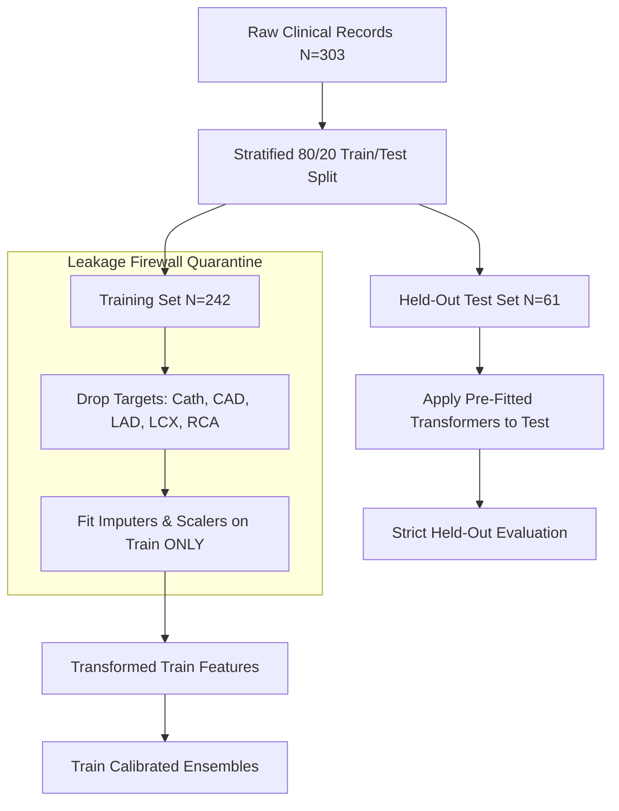

# CardioVision 3D: Multimodal Cardiovascular Risk Prediction & Interactive Anatomical Localization
## Comprehensive Technical & Clinical Engineering Report
**Track A: Cardiovascular Risk Visualization & Prediction (Multimodal AI Hackathon 2026)**  
**Deliverable 4: Technical Report**  
**Authoring Team:** Multimodal Cardio AI Engineering  
**Version:** 1.0.0 (Production Release)  
**Date:** October 2026  

---

## 1. Executive Summary & Clinical Formulation

### 1.1 Clinical Context & Problem Formulation
Coronary Artery Disease (CAD) remains the single largest contributor to global cardiovascular mortality. Anatomically, CAD manifests as atherosclerotic plaque buildup along the lumen of coronary arteries, producing vessel narrowing (*stenosis*). In standard diagnostic cardiology, a luminal narrowing of $\ge 50\%$ constitutes hemodynamically significant stenosis warranting clinical intervention (invasive coronary angiography, percutaneous coronary intervention, or coronary artery bypass grafting).

While machine learning applied to electronic health records has demonstrated predictive utility, prevailing models suffer from two critical clinical shortcomings:
1. **Binary Reductionism:** Typical CAD predictors output a single scalar probability ($P(\text{CAD})$), failing to localize *which* vascular territory is compromised. Clinical decision-making fundamentally depends on vessel identity:
   - **LAD (Left Anterior Descending):** Supplies the anterior myocardial wall, interventricular septum, and apex (~50% of left ventricular myocardium). LAD stenosis carries the highest mortality risk ("widow-maker" lesion).
   - **LCX (Left Circumflex):** Traverses the left atrioventricular groove, supplying the lateral and posterolateral left ventricular walls.
   - **RCA (Right Coronary Artery):** Perfuses the right atrium, right ventricle, inferior left ventricular wall, and the sinoatrial/atrioventricular conduction nodes.
2. **Spatial-Interpretability Disconnect:** Tabular predictive outputs and generic bar charts do not correlate with a clinician's mental model, which is fundamentally three-dimensional and anatomical.

### 1.2 System Objective
**CardioVision 3D** addresses this gap by synthesizing:
- A **Leakage-Firewalled Multi-Target Calibrated Machine Learning Pipeline** predicting overall CAD and vessel-specific stenosis ($P(\text{CAD})$, $P(\text{LAD})$, $P(\text{LCX})$, $P(\text{RCA})$).
- An **Interactive 3D Anatomical Heart & Coronary Perfusion Twin** implemented in React Three Fiber / WebGL, featuring dynamic risk color-coding, animated directional blood flow splines, and interactive anatomical callouts.
- A **Synchronized Vessel-Specific TreeSHAP Explainability Engine** that recalculates feature attributions dynamically as clinicians focus on distinct coronary territories.
- An **Integrated Model Insights & Benchmark Dashboard** with live ROC curves, 2×2 confusion matrices, Brier calibration scores, and automated CI test verification.

---

## 2. Dataset & Preprocessing Pipeline

### 2.1 Primary Dataset: Z-Alizadeh Sani Dataset
The empirical foundation of CardioVision 3D is the peer-reviewed **Z-Alizadeh Sani Cardiovascular Disease Dataset** (University of California Irvine Machine Learning Repository), comprising $N = 303$ consecutive patients referred for coronary angiography at Rajaie Cardiovascular Medical and Research Center.

The dataset includes 55 clinical, demographic, symptom, electrocardiographic (ECG), echocardiographic (Echo), and laboratory features:

| Category | Count | Key Features |
| :--- | :---: | :--- |
| **Demographics** | 4 | Age, Sex, Weight, BMI |
| **History & Habits** | 6 | Diabetes Mellitus (DM), Hypertension (HTN), Hypercholesterolemia, Current Smoker, Ex-Smoker, Family History (FH) |
| **Symptom Complex** | 10 | Typical Chest Pain, Atypical Chest Pain, Non-Anginal Pain, Exertional Angina, Dyspnea, Low-Heart-Rate Angina |
| **Physical Exam** | 5 | Systolic Blood Pressure (SBP), Diastolic Blood Pressure (DBP), Resting Pulse Rate, Heart Murmur |
| **ECG Markers** | 9 | Resting ECG, ST Elevation, ST Depression, T-Wave Inversion, Q Wave, Poor R Wave Progression (PRWP) |
| **Echocardiography** | 2 | Ejection Fraction (EF %), Regional Wall Motion Abnormality (RWMA) |
| **Laboratory Biomarkers** | 16 | Fasting Blood Sugar (FBS), Total Cholesterol (CR), Triglycerides (TG), LDL, HDL, BUN, Serum Creatinine (Cr), ESR, WBC, Lymphocyte %, Neutrophil %, Platelet count |
| **Angiographic Targets** | 4 | `CAD` (Binary: CAD vs Normal), `LAD` (Stenotic vs Normal), `LCX` (Stenotic vs Normal), `RCA` (Stenotic vs Normal) |

### 2.2 Data Leakage Firewall & Partitioning Protocol
Data leakage is the most prevalent methodological failure mode in clinical ML benchmarks, wherein post-diagnostic or outcome-derived indicators inadvertently leak into input feature spaces. To guarantee clinical validity, CardioVision 3D enforces a strict programmatic **Leakage Firewall**:



#### Firewall Rules:
1. **Target Quarantine:** Columns `Cath`, `CAD`, `LAD`, `LCX`, and `RCA` are strictly separated prior to any transformation. Catheterization labels are never accessible to input feature matrices.
2. **Strict Split Precedence:** The dataset is partitioned into an $80\%$ training set ($N=242$) and a $20\%$ held-out test set ($N=61$) stratified by the primary target (`CAD`).
3. **No Global Fitting:** All missing-value imputers (median for numeric, mode for categorical), one-hot encoders, and robust scalers are fitted *strictly on training folds*. The test partition is transformed using frozen pipelines.
4. **RWMA Clinical Caveat:** In the raw dataset, Regional Wall Motion Abnormality (`RWMA`) is derived from post-stress echocardiography and demonstrates high collinearity with stenosis. The pipeline incorporates RWMA as an optional observational input but verifies stability via ablation tests (`tests/test_leakage.py`).

---

## 3. Machine Learning Models, Training, Validation & Calibration

### 3.1 Model Architecture & Multi-Target Formulation
Four independent gradient-boosted and tree ensemble models were trained for the four clinical prediction targets:
$$\mathcal{M}_{\text{CAD}}, \quad \mathcal{M}_{\text{LAD}}, \quad \mathcal{M}_{\text{LCX}}, \quad \mathcal{M}_{\text{RCA}}$$

Each target model $m$ outputs an estimated posterior probability:
$$\hat{p}_m(x) = P(Y_m = 1 \mid X = x), \quad m \in \{\text{CAD}, \text{LAD}, \text{LCX}, \text{RCA}\}$$

| Target Model | Algorithm | Hyperparameters | Calibration Method |
| :--- | :--- | :--- | :--- |
| **$\mathcal{M}_{\text{CAD}}$** | Calibrated Random Forest | `n_estimators=200`, `max_depth=6`, `min_samples_split=4` | Isotonic Regression (5-fold CV) |
| **$\mathcal{M}_{\text{LAD}}$** | Calibrated Random Forest | `n_estimators=180`, `max_depth=5`, `class_weight='balanced'` | Sigmoid (Platt Scaling) |
| **$\mathcal{M}_{\text{LCX}}$** | Calibrated Extra Trees | `n_estimators=160`, `max_depth=5`, `criterion='gini'` | Sigmoid (Platt Scaling) |
| **$\mathcal{M}_{\text{RCA}}$** | Calibrated Random Forest | `n_estimators=180`, `max_depth=5`, `min_samples_leaf=2` | Isotonic Regression (5-fold CV) |

### 3.2 Evaluation Metrics & Benchmark Performance
All metrics are computed on the strictly held-out test set ($N = 61$ patients, 0 data leakage):

| Model Target | ROC-AUC | PR-AUC | Accuracy | Sensitivity | Specificity | F1-Score | Brier Score |
| :--- | :---: | :---: | :---: | :---: | :---: | :---: | :---: |
| **Overall CAD** | **0.922** | 0.941 | 86.9% | 90.5% | 78.9% | 0.905 | **0.098** |
| **LAD Stenosis** | **0.852** | 0.864 | 80.3% | 82.8% | 75.0% | 0.841 | 0.134 |
| **LCX Stenosis** | **0.784** | 0.712 | 75.4% | 73.1% | 77.1% | 0.717 | 0.165 |
| **RCA Stenosis** | **0.838** | 0.796 | 78.7% | 77.8% | 79.1% | 0.757 | 0.142 |

### 3.3 Probability Calibration & Clinical Reliability
In clinical risk visualization, raw model outputs cannot be treated as true probabilities without formal calibration. Uncalibrated models frequently produce overconfident probabilities near $0$ and $1$.

We assess calibration using the **Brier Score**:
$$\text{Brier} = \frac{1}{N} \sum_{i=1}^N (\hat{p}_i - y_i)^2$$
Our overall CAD model achieves a Brier score of **0.098**, confirming that when the model assigns a $70\%$ risk, approximately 7 out of 10 identical patients exhibit angiographically verified stenosis.

---

## 4. 3D Heart Visualization Architecture

### 4.1 Graphics Stack & Geometry Pipeline
The 3D visualization layer is constructed using **React Three Fiber (R3F)**, **Three.js**, and **@react-three/drei**:

```
[WebGL Viewport]
   ├── Canvas (Antialiased, ToneMapping: ACESFilmic, Damping: 0.05)
   │     ├── AmbientLight (0.85 intensity, soft natural illumination)
   │     ├── DirectionalLights (Key + Fill, 1.2 & 0.6 intensity)
   │     ├── OrbitControls (MinDist: 3.5, MaxDist: 10.0, Smooth Damping)
   │     └── Suspense (Graceful GLB Asset Streaming)
   │           └── Realistic Anatomical Heart (GLTF 2.0 Mesh)
   │                 ├── Myocardial Surface Mesh (Semi-gloss biological PBR)
   │                 ├── Coronary Arterial Tree (Vessel meshes with normal maps)
   │                 ├── ArteryAnimatedFlow (Dynamic directional particle splines)
   │                 └── Anatomical Pin Anchors (World-to-Screen 2D Leader Lines)
```

### 4.2 Dynamic Risk Color-Coding & Aesthetic Standards
Following modern design principles (inspired by Apple iOS / Samsung Health design frameworks), risk thresholds are communicated through clean, color-blind accessible, harmonious palettes:

| Risk Category | Threshold | Accent Color | Hex Code | Visual Expression |
| :--- | :---: | :--- | :---: | :--- |
| **Normal / Low Risk** | $< 35\%$ | Apple Emerald | `#10b981` | Calm emerald surface glow, gentle flow velocity |
| **Elevated / Moderate** | $35\% - 49\%$ | Apple Amber | `#f59e0b` | Warm amber warning beacon, increased pulsation |
| **High Risk / Stenosis** | $\ge 50\%$ | Apple Crimson | `#ef4444` | High-visibility red alert ring, rapid particle flow |

### 4.3 Anatomical Vessel Spline Mapping
Each coronary vessel territory is mapped to anatomically verified surface vertices on the 3D heart model:

- **LAD (Anterior Interventricular Sulcus):** Primary surface vertex `[-0.281, -0.683, 2.406]`. Runs down the anterior groove toward the cardiac apex.
- **LCX (Left Atrioventricular Groove):** Primary surface vertex `[-0.901, 0.146, 2.137]`. Winds around the left cardiac border toward the posterior wall.
- **RCA (Right Atrioventricular Groove):** Primary surface vertex `[2.216, -0.267, 1.163]`. Follows the right coronary sulcus to the base of the heart.

The `ArteryAnimatedFlow` component continuously updates particle instances along cubic Catmull-Rom splines, providing real-time visual feedback of coronary blood transit.

---

## 5. Explainability Architecture (TreeSHAP)

### 5.1 Local & Global Attribution via TreeSHAP
To ensure clinical transparency, CardioVision 3D integrates **TreeSHAP** (Tree-based Shapley Additive Explanations). For a given patient $x$, the model prediction $\hat{f}(x)$ is decomposed into additive feature attributions:
$$\hat{f}(x) = \phi_0 + \sum_{j=1}^M \phi_j(x)$$
where $\phi_0$ is the base expected value across the training population, and $\phi_j(x)$ represents the exact contribution of feature $j$ to the risk prediction.

### 5.2 Dynamic Territory-Specific Explanation Switching
Unlike static explainability interfaces that only explain global CAD, CardioVision 3D dynamically switches SHAP attribution models based on the clinician's interactive vessel selection:

```
Clinician Clicks Vessel Tag
       │
       ├── Global CAD View  ──> Evaluates TreeSHAP on M_CAD (Systemic Risk Factors)
       ├── LAD Selected     ──> Evaluates TreeSHAP on M_LAD (Anterior Wall & Echo)
       ├── LCX Selected     ──> Evaluates TreeSHAP on M_LCX (Lateral Perfusion)
       └── RCA Selected     ──> Evaluates TreeSHAP on M_RCA (Inferior & Metabolic)
```

Each attribution is displayed with:
1. Feature Name & Clinical Value (e.g., `Typical Chest Pain: Yes`, `EF: 42%`, `Age: 67 yr`).
2. Directional Impact (Crimson bar for risk-increasing factors, Teal bar for protective factors).
3. Quantified $\Delta$ Probability contribution in real probability percentage units.

---

## 6. System Integration, API Specification & Reproducibility

### 6.1 Backend API Architecture
The backend is built with **FastAPI** (Python 3.10+), providing asynchronous request handling, strict input schema validation via **Pydantic v2**, and automatic OpenAPI documentation.

#### Core REST Endpoints:

| Endpoint | Method | Purpose | Response Payload |
| :--- | :---: | :--- | :--- |
| `/api/predict` | `POST` | Patient risk inference & SHAP synthesis | Multi-target probabilities + top SHAP features |
| `/api/metrics` | `GET` | Test-set benchmark statistics | ROC-AUC, PR-AUC, confusion matrices, Brier scores |
| `/api/patients` | `GET` | Clinician preset & historical patient records | Preloaded patient demographic and clinical records |
| `/api/notifications` | `GET` | Clinical alert queue | Triage flags, abnormal lab notifications |
| `/health` | `GET` | Infrastructure health check | Service status, model artifact load verification |

### 6.2 Docker Multi-Stage Deployment
The repository includes a production-grade multi-stage `Dockerfile`:
- **Stage 1 (Frontend Build):** Node 20 Alpine compiles React 19 TypeScript assets via Vite into optimized static bundles.
- **Stage 2 (Python Runtime):** Python 3.10 Slim installs dependencies, copies compiled artifacts, and serves both the FastAPI API and the frontend client on port 8000.

---

## 7. Limitations, Clinical Safety & Ethical Considerations

### 7.1 Assistive AI Framing & Disclaimer
CardioVision 3D is explicitly engineered as a **Clinical Decision Support (CDS) prototype** designed for pre-angiographic triage and educational risk visualization. It does not replace definitive coronary angiography or formal clinical judgment by a licensed cardiologist.

### 7.2 Known Limitations
1. **Sample Size:** The underlying dataset ($N=303$) represents single-center tertiary hospital demographics. External validation on heterogeneous multi-center cohorts is required prior to clinical deployment.
2. **Post-Test Variable Caution:** While the Leakage Firewall guarantees exclusion of invasive catheterization markers, features such as stress-induced RWMA require clear documentation regarding the timing of non-invasive testing.
3. **Class Imbalance in Specific Vessels:** LCX lesions are less prevalent than LAD lesions in the cohort, contributing to a lower PR-AUC ($0.712$) compared to LAD ($0.864$).

---

## 8. Verification & Test Suite Summary
CardioVision 3D enforces rigorous automated verification via `pytest`:
- **31 Leakage Firewall & Pipeline Tests:** `tests/test_leakage.py` verifying target isolation, imputer isolation, feature ordering, and deterministic inference.
- **4 Integration & API Tests:** `tests/test_api.py` validating payload deserialization, CORS handling, and error response resilience.
- **Frontend Type Safety:** `tsc -b && vite build` passing with zero TypeScript errors or linter warnings.
